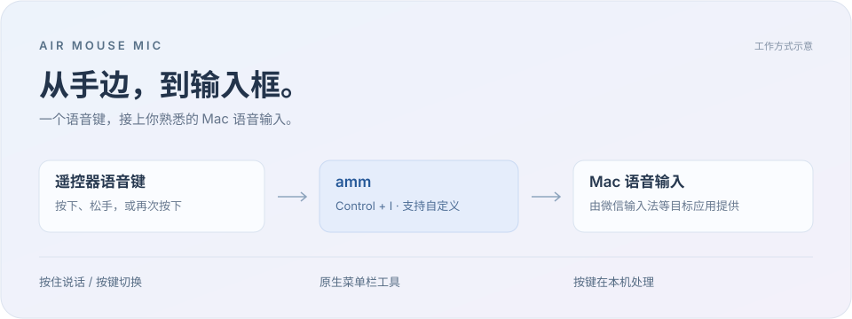

<div align="center">

# air-mouse-mic

### 手边的语音键，Mac 上的输入开关。

让空中飞鼠连接你的语音输入工作流。


[开始使用](#开始使用) · [功能](#功能) · [安装](#安装) · [常见问题](#常见问题) · [反馈建议](https://github.com/lilonghe/air-mouse-mic/issues)



</div>

**air-mouse-mic（amm）** 是一款 macOS 菜单栏工具，将 T1-Remote 空中飞鼠的语音键映射为键盘快捷键。按下手里的语音键，即可调用微信输入法的语音输入。

默认使用 <kbd>Control</kbd> + <kbd>I</kbd>，也支持录制其他组合键，配合支持相应快捷键的应用使用。语音采集和识别由目标应用负责，amm 专注于按键连接。

## 功能

| 按你的习惯说话 | 在菜单栏掌握状态 |
| :--- | :--- |
| **长按触发**：按下时保持快捷键，松手时释放。 | **状态反馈**：查看设备连接、按键触发状态和当前模式。 |
| **短按切换**：按一次保持快捷键，再按一次释放。 | **连接动效**：三点明暗变化表示连接中，支持减少动态效果。 |
| **自定义快捷键**：点击录制，模式和组合键自动保存。 | **断线重连**：启用期间自动重试连接，可随时关闭。 |

amm 在本机接收遥控器按键、发送快捷键，不采集遥控器音频。目标应用的录音、识别和联网行为由其自身设置及隐私政策决定。

## 安装

### 准备环境

| 项目 | 要求 |
| --- | --- |
| 系统 | macOS 13 或更新版本 |
| 遥控器 | 已验证 T1-Remote，需先与 Mac 完成蓝牙配对并连接 |
| 语音输入 | 已验证微信输入法，目标应用的语音功能与快捷键需单独配置 |
| 构建环境 | Xcode 或 Command Line Tools，支持 Swift tools 5.9 或更新版本 |

> [!NOTE]
> 当前提供源码构建。其他外观相似的空中飞鼠未必使用相同协议，兼容性需另行验证。

### 构建并运行

```bash
git clone https://github.com/lilonghe/air-mouse-mic.git
cd air-mouse-mic
./build.sh
open build/air-mouse-mic.app
```

构建后的应用位于 `build/air-mouse-mic.app`。也可以将它移至「应用程序」文件夹，在固定位置运行和授权。

### 首次授权

1. 按系统提示允许 **蓝牙访问**，用于接收遥控器按键。
2. 前往 **系统设置 → 隐私与安全性 → 辅助功能**，开启 **air-mouse-mic**，用于发送快捷键。
3. 返回应用，再按一次遥控器语音键即可重新检查权限。

> [!IMPORTANT]
> 源码构建使用临时签名。重新构建或替换应用后，旧授权可能失效；如果权限已开启但按键无效，请移除旧条目，再添加当前应用并授权。

## 开始使用

1. 在 macOS 蓝牙设置中连接 **T1-Remote**。
2. 确认直接按下 `Control + I` 能唤起微信输入法语音输入，或先在目标应用中配置自己的快捷键。
3. 点击 amm 的菜单栏图标，打开面板**右上角的小开关**，等待显示 **已连接**。
4. 按下遥控器语音键，调用语音输入。

语音模式、触发快捷键与日志导出直接位于系统菜单中，无需切换设置页。移到 **语音模式** 打开侧边选项；移到 **触发快捷键** 打开侧边菜单后按下新的组合键，按 `Esc` 取消录制。

### 选择操作方式

| 模式 | 按键行为 |
| --- | --- |
| 长按触发 | 按下语音键时按住快捷键，松手时释放，适合按住说话 |
| 短按切换 | 第一次按下时保持快捷键，第二次按下时释放，适合一次开始、再次结束 |

amm 会在快捷键保持超过 60 秒时自动释放。短按切换期间，组合键中的修饰键也会保持按下，可能影响其他键盘操作；需要边说边操作电脑时，建议先确认目标应用的交互方式。

## 权限与状态说明

开启辅助功能权限后，再次按下遥控器语音键即可重新检查授权。菜单栏的语音状态表示 amm 正在保持快捷键，实际是否开始录音，以微信输入法或目标应用的提示为准。

设备断连后会进入连接中状态。当前无法可靠区分设备休眠、关机或超出蓝牙范围。

## 常见问题

<details>
<summary><strong>显示已连接，但没有唤起语音输入？</strong></summary>

先用键盘直接测试同一组合键，再检查 amm 的辅助功能权限和设置中的快捷键是否一致。目标应用使用哪个麦克风，由目标应用或 macOS 的音频设置决定。

</details>

<details>
<summary><strong>一直显示连接中？</strong></summary>

确认遥控器已与 Mac 连接，尝试按键唤醒设备，再检查系统蓝牙是否开启。

</details>

<details>
<summary><strong>如何提交问题反馈？</strong></summary>

点击菜单面板中的 **导出日志…** 保存运行日志，并通过 [GitHub Issues](https://github.com/lilonghe/air-mouse-mic/issues) 说明 macOS 版本、遥控器型号、触发步骤与实际现象。分享前请检查日志内容。

日志保存在本机 `~/Library/Logs/amm/amm.log`。

</details>

---

欢迎通过 [Issues](https://github.com/lilonghe/air-mouse-mic/issues) 反馈兼容设备与使用建议，或通过 [Pull requests](https://github.com/lilonghe/air-mouse-mic/pulls) 参与改进。
